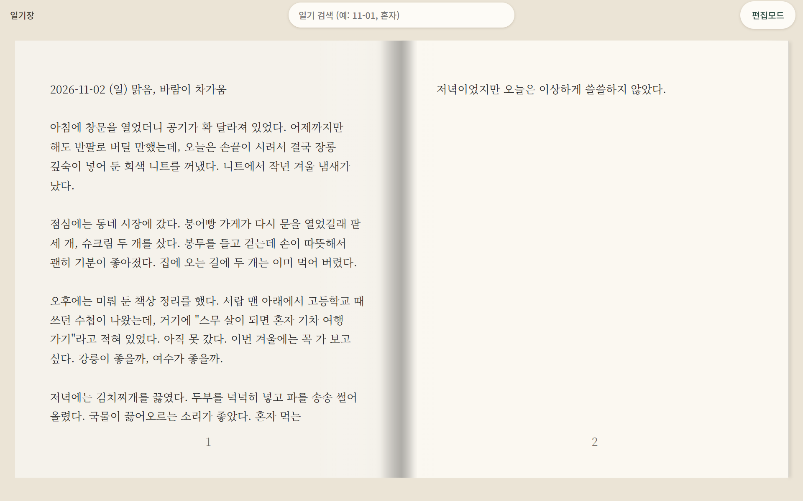
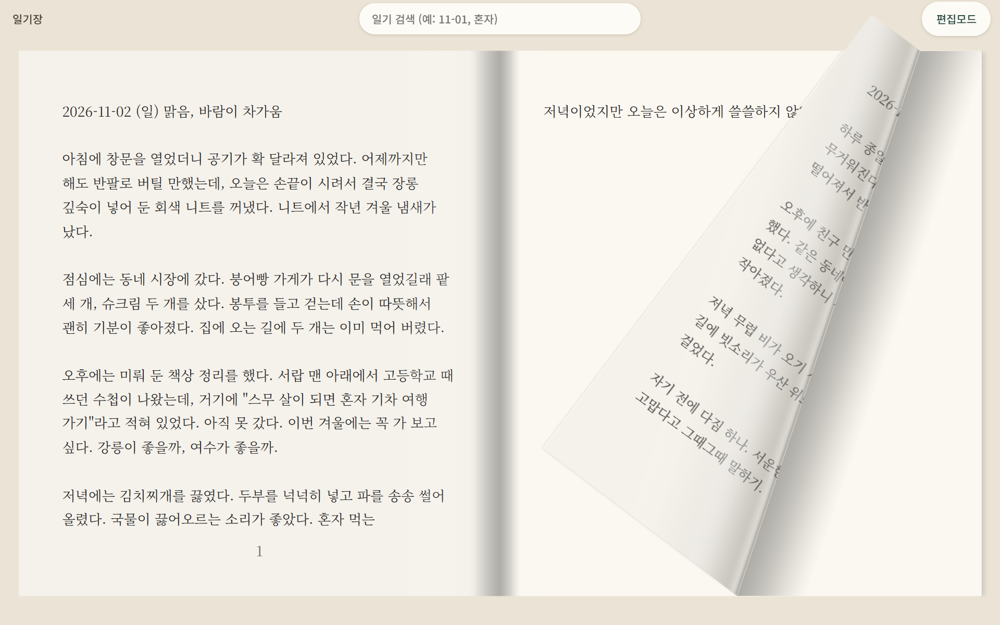

# 펼친 책 일기장

처음부터 펼친 책으로 열리는 일기장 웹사이트입니다.





> 화면의 일기는 예시로 지어낸 글입니다.

- **편집모드**를 누르면 보이는 화면 그대로 글을 고칠 수 있고, **저장**하면 글자만 바뀝니다.
- **새 일기**를 누르면 맨 앞 쪽에 새 일기가 생기고 기존 일기는 다음 쪽으로 밀립니다.
- 일기 글은 쪽을 빈칸 없이 이어서 채웁니다.
- 위쪽 **검색** 칸에 날짜나 낱말을 넣으면 찾은 자리를 보여 주고, 누르면 그 쪽을 엽니다.
- PC는 양쪽 펼침면, 폰 세로는 한 쪽, 폰 가로는 펼침면으로 화면을 채웁니다.
- 로그인이 없어서 주소를 아는 사람은 누구나 읽고 고칠 수 있습니다.

## 구성

- `public/` — 화면 (`index.html`, `style.css`, `app.js`)
- `worker/index.js` — Cloudflare Worker. `/api/pages` 로 일기를 D1 에 저장·불러오기
- `vendor/page-flip/` — 책 넘김 엔진 (StPageFlip 수정판, MIT). `npm run build` 로 `public/page-flip.js` 를 만듭니다.

## 실행

```bash
npm install
cp wrangler.example.jsonc wrangler.jsonc   # 설정 파일 만들기
npm run dev      # http://localhost:8790
```

## Cloudflare 에 올리기

```bash
npx wrangler d1 create diary   # 나온 database_id 를 wrangler.jsonc 에 넣기
npm run deploy
```

## 라이선스

MIT — [LICENSE](LICENSE). 책 넘김 엔진(`vendor/page-flip/`)은 StPageFlip(MIT, Nodlik)을 고친 것이라 그 폴더의 LICENSE 도 따릅니다.
